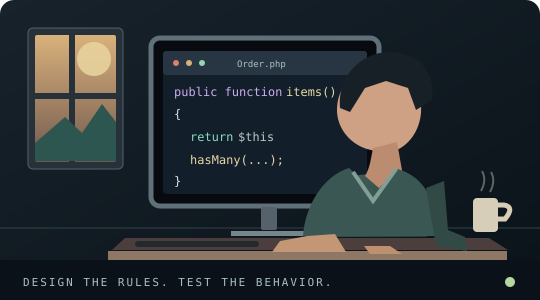
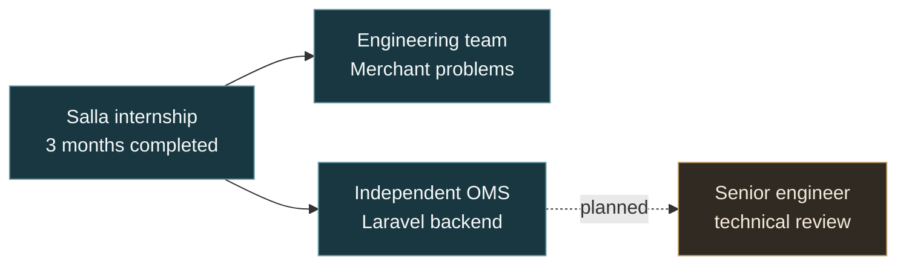

<!-- GitHub profile: self-hosted visuals, licensed icon set, and private-project descriptions. -->

<p align="center">
  <picture>
    <source media="(max-width: 600px)" srcset="./assets/identity-mobile.svg">
    
  </picture>
</p>

<p align="center">
  <a href="https://www.linkedin.com/in/abdulrahman-banafea-a7237034a/"></a>
  <a href="mailto:abdulrahmanba707@gmail.com"></a>
  <a href="https://github.com/IAM707"></a>
</p>

<p align="center"><samp>Backend engineering &nbsp;·&nbsp; Product thinking &nbsp;·&nbsp; Building things that work</samp></p>

---

### 👋 About Me

<table><tr>
<td width="57%" valign="middle">
<p>I'm <strong>Abdulrahman</strong>, a software engineering student and backend-focused developer in Jeddah, Saudi Arabia.</p>
<p>I care about more than making code run. I want to understand the domain, solve real problems, and know how a system behaves when something goes wrong.</p>
<ul>
<li><strong>At Salla:</strong> working with an engineering team on real merchant problems.</li>
<li><strong>Independently:</strong> building a Laravel Order Management System to practice backend engineering end to end.</li>
<li><strong>Beyond backend:</strong> developing <strong>MAJRA Studio</strong>, a Saudi digital-studio project focused on business websites and useful web functionality.</li>
</ul>
</td>
<td width="43%" valign="middle"></td>
</tr></table>

### 💼 Current Role & Experience

> **Software Engineering Intern — Salla**
>
> Three months completed; **continuing** with an engineering team to investigate and solve merchant problems. I'm learning how debugging, collaboration, implementation choices, and maintainability connect to actual business outcomes.

| Focus | What I'm doing |
| :--- | :--- |
| **Team engineering** | Collaborating on real merchant-facing problems at Salla |
| **Backend development** | Practicing PHP, Laravel, relational modeling, API design, and testing |
| **Engineering discipline** | Git branches, pull requests, automated tests, documentation, and technical feedback |
| **Next milestone** | Continuing my OMS and seeking a senior engineer's technical review |

### 🧭 Engineering Journey



<sub>Team work and independent OMS development are separate, ongoing tracks. The senior technical review is planned, not completed.</sub>

### 🧩 Selected Work

<table><tr>
<td width="50%" valign="top">
<h4>01 · Order Management System</h4>
<p><code>PRIVATE</code> · <code>IN DEVELOPMENT</code></p>
<p>An independent Laravel backend project to understand how business systems are modeled, implemented, and maintained.</p>
<p><strong>Working on:</strong> domain models, orders, database constraints, feature tests, and system design.</p>
<p><strong>Next:</strong> integrations, reliability, asynchronous work, and senior technical feedback.</p>
<p><code>PHP</code> <code>Laravel</code> <code>PostgreSQL</code> <code>Pest</code></p>
</td>
<td width="50%" valign="top">
<h4>02 · MAJRA Studio</h4>
<p><code>PRIVATE</code> · <code>IN DEVELOPMENT</code></p>
<p>A Saudi digital-studio project focused on distinctive yet practical websites for established businesses.</p>
<p><strong>Focus:</strong> bespoke business websites, CMS, Arabic-first interfaces, and focused integrations.</p>
<p><strong>Approach:</strong> thoughtful UI/UX supported by working, useful functionality.</p>
<p><code>React</code> <code>TypeScript</code> <code>Web Engineering</code></p>
</td>
</tr></table>

> Both repositories are private. No employer code, merchant information, or internal business data is shared here.

### 🛠 Tech Arsenal

<details open>
<summary><b>Backend &amp; Data</b> — PHP, Laravel, PostgreSQL, Node.js, Supabase</summary>

<p align="center">
  
  
  
  
  
</p>

<p align="center"><sub>Core focus: PHP · Laravel · PostgreSQL · Eloquent ORM · REST APIs · Pest feature tests</sub></p>
</details>

<details open>
<summary><b>Frontend &amp; Web</b> — React, TypeScript, Next.js, Tailwind</summary>

<p align="center">
  
  
  
  
  
  
  
  
</p>

<p align="center"><sub>React · TypeScript · JavaScript · Next.js · Tailwind CSS · HTML · CSS · Vite</sub></p>
</details>

<details open>
<summary><b>Developer Tools</b> — Git, GitHub, Postman, VS Code</summary>

<p align="center">
  
  
  
  
</p>

<p align="center"><sub>Git branches · pull requests · code reviews · automated testing · API inspection</sub></p>
</details>

<sub>Tools I use or am learning—not a claim of expert proficiency in everything shown.</sub>

### ⚙️ What I Bring

```typescript
const engineeringMindset = {
  startWith: "understand the problem and domain",
  designFor: ["correctness", "clarity", "failure cases"],
  buildWith: ["small changes", "tests", "code review"],
  measureBy: "working software and verified behavior",
  keepDoing: "learning from real feedback",
} as const;
```

I'm building strong **backend engineering judgment**, while continuing to care about the quality and usability of the full product.

### 📊 GitHub Activity

My primary projects are currently private, so public repository and language charts would not show the full picture. GitHub's native contribution calendar below this README is the best place to see the activity my account is configured to share.

<p align="center">
  <a href="https://github.com/IAM707?tab=overview"><b>View activity</b></a>
  &nbsp; · &nbsp;
  <a href="https://github.com/IAM707?tab=repositories"><b>Public repositories</b></a>
</p>

---

<p align="center"><b>Build thoughtfully. Test deliberately. Keep improving.</b></p>
<p align="center"><sub>Abdulrahman Banafea · Jeddah, Saudi Arabia</sub></p>
