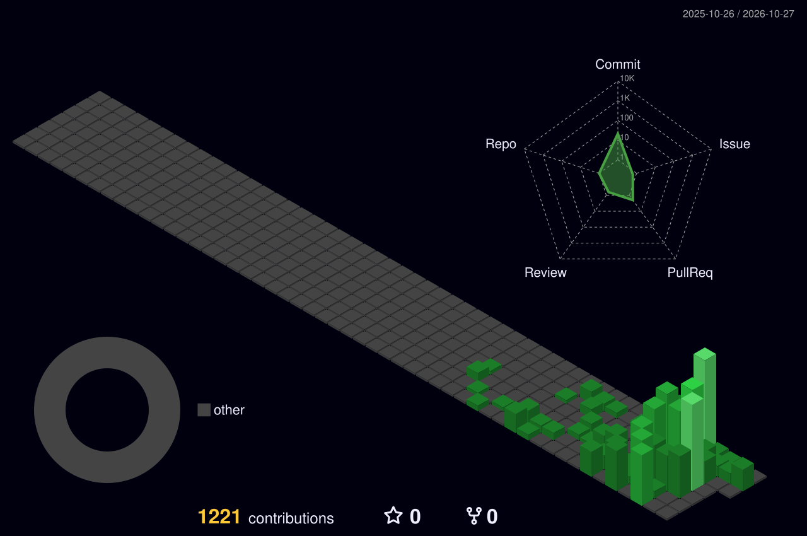

<div align="center">


[](https://git.io/typing-svg)

</div>

---

## 🎯 **ABOUT ME**

```typescript
const abdulrahman = {
  basedIn: "Jeddah, Saudi Arabia",
  focus: "Software Engineering / Backend",
  experience: "Salla internship — 3 months completed, ongoing",
  workingOn: [
    "Solving merchant problems with an engineering team",
    "Independent Laravel Order Management System",
    "MAJRA Studio — business websites and web solutions"
  ],
  approach: ["Understand", "Build", "Test", "Review"],
};
```

I'm a software engineering student, currently working with a team on real merchant problems at **Salla**, while building a private Laravel OMS independently to improve my backend and system-design skills.

<!-- Animation credit: Anmol Baranwal / Cool-GIFs-For-GitHub (Work with Coffee). -->
<p align="center">
  <a href="https://github.com/Anmol-Baranwal/Cool-GIFs-For-GitHub">
    
  </a>
</p>

---

## 💼 **CURRENT ROLES**

| Work | What I am doing | Status |
| :--- | :--- | :--- |
| **Salla · Software Engineering Intern** | Collaborating on real merchant problems | Ongoing · 3 months completed |
| **Independent OMS** | Laravel, database modeling, order workflows, tests | Private · In development |
| **MAJRA Studio** | Arabic-first business websites, CMS, and integrations | Private · In development |
| **Senior OMS review** | External technical evaluation of my own project | Planned |

---

## 🚀 **SELECTED PROJECTS**

<table><tr>
<td width="50%" valign="top">
<h3>Order Management System</h3>
<p><code>PRIVATE</code> <code>IN DEVELOPMENT</code></p>
<p>An independently built Laravel backend system exploring orders, domain models, API design, relational data, testing, and integration reliability.</p>
<p><code>PHP</code> <code>Laravel</code> <code>PostgreSQL</code> <code>Pest</code></p>
</td>
<td width="50%" valign="top">
<h3>MAJRA Studio</h3>
<p><code>PRIVATE</code> <code>IN DEVELOPMENT</code></p>
<p>Building a Saudi digital studio focused on useful, thoughtfully designed business websites, content management, and selected web integrations.</p>
<p><code>React</code> <code>TypeScript</code> <code>Design</code></p>
</td>
</tr></table>

<sub>The two projects are private. No employer code, restricted information, or merchant data is shared.</sub>

---

## 🛠️ **TECH STACK & TOOLS**

<div align="center">

### ⚙️ Backend & Databases
     

### 🎨 Frontend & Web
      

### 🔧 Developer Tools
      

</div>

---

## 🧭 **ENGINEERING APPROACH**

```text
Problem → Domain & Constraints → Design → Implement → Test → Review
```

I focus on understanding how software behaves, especially when something goes wrong. I'm learning production-minded engineering through real work, automated testing, and technical feedback.

---

## 📊 **GITHUB ACTIVITY**

<div align="center">


</div>

### 🐍 Contribution Snake

<div align="center">
  <picture>
    <source media="(prefers-color-scheme: dark)" srcset="https://raw.githubusercontent.com/IAM707/IAM707/output/github-snake-dark.svg">
    <source media="(prefers-color-scheme: light)" srcset="https://raw.githubusercontent.com/IAM707/IAM707/output/github-snake.svg">
    
  </picture>
</div>

### 🌆 3D Contribution City

<div align="center">
  
</div>

<sub>These animations are generated from available GitHub contribution data and refreshed by GitHub Actions. Private repository details are not disclosed.</sub>

<sub>Public statistics do not capture every contribution made to private projects.</sub>

---

## 📱 **CONNECT WITH ME**

<div align="center">

<a href="https://www.linkedin.com/in/abdulrahman-banafea-a7237034a/"></a>
<a href="mailto:abdulrahmanba707@gmail.com"></a>
<a href="https://github.com/IAM707"></a>

</div>

---

<div align="center">


**Build thoughtfully. Test deliberately. Keep learning.**

<sub>Layout adapted from <a href="https://github.com/kaali-k/kaali-k">Kaali's GitHub profile</a> (MIT-licensed template).</sub>


</div>
