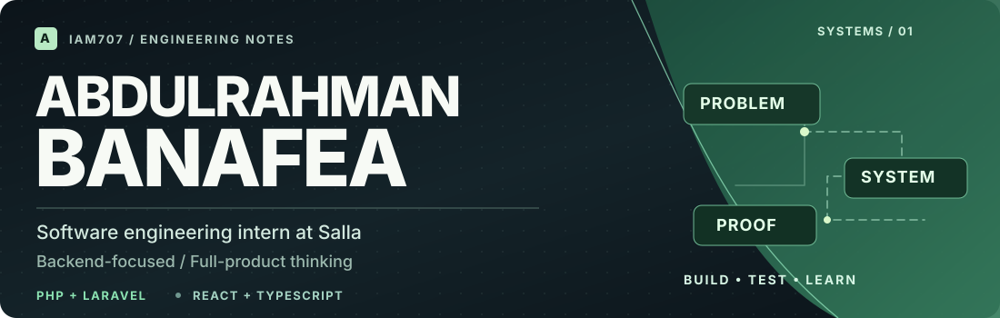
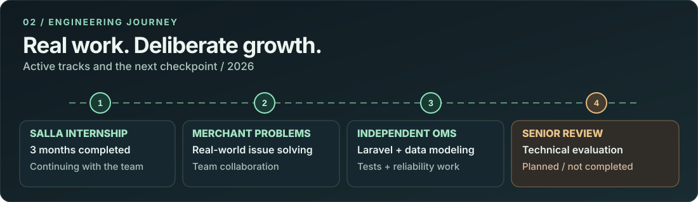
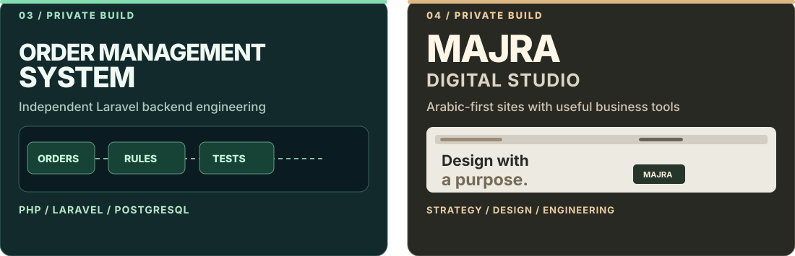

<!--
SYSTEMS ATLAS — IAM707
Original artwork: assets/atlas-*.svg
Tech icons: locally vendored from tandpfun/skill-icons (MIT), see assets/THIRD_PARTY_NOTICES.md
All written experience is descriptive. Private source code and merchant information are not published.
-->

<div align="center">
  <picture>
    <source media="(max-width: 600px)" srcset="./assets/atlas-hero-mobile.svg">
    
  </picture>
</div>

<p align="center">
  <a href="https://www.linkedin.com/in/abdulrahman-banafea-a7237034a/"></a>
  <a href="mailto:abdulrahmanba707@gmail.com"></a>
  <a href="https://github.com/IAM707"></a>
</p>

<div align="center">
  <samp>ENGINEERING NOTES  /  JEDDAH, SA  /  BACKEND & PRODUCT SYSTEMS</samp>
</div>

---

### 01 / About me

<table>
<tr>
<td width="58%" valign="middle">
  <p><b>Hey, I'm Abdulrahman.</b> I'm a software engineering student and backend-focused developer. I build practical web systems and work on becoming better at the decisions behind the code.</p>
  <p>I want to know <b>what problem a system solves, which rules it must protect, and how we can verify that it works</b>—not just make the happy path run.</p>
  <p>Currently: collaborating on merchant problems at <b>Salla</b>, independently developing a Laravel <b>Order Management System</b>, and building <b>MAJRA Studio</b>.</p>
</td>
<td width="42%" valign="middle">
  
</td>
</tr>
</table>

<table>
<tr align="center">
<td width="33%"><b>03 months</b><br><sub>Salla internship completed</sub></td>
<td width="33%"><b>02 builds</b><br><sub>OMS + MAJRA (private)</sub></td>
<td width="34%"><b>01 team</b><br><sub>Solving merchant problems</sub></td>
</tr>
</table>

### 02 / Current roles

<table>
<tr>
<td width="59%" valign="top">
  <h4>Software Engineering Intern · Salla</h4>
  <p>Three months completed, and continuing with an engineering team working on real problems affecting merchants.</p>
  <p><b>What I'm practicing:</b> investigation, debugging, team collaboration, understanding existing systems, and delivering carefully reviewed changes.</p>
  <p><code>TEAM ENGINEERING</code> <code>ONGOING</code></p>
</td>
<td width="41%" valign="top">
  <h4>Independent Backend Practice</h4>
  <p>Building my own Order Management System to deepen my PHP/Laravel, relational modeling, testing, and reliability skills.</p>
  <p>I'll seek a senior engineer's technical evaluation of the project when it's ready.</p>
  <p><code>OMS</code> <code>PRIVATE</code> <code>IN PROGRESS</code></p>
</td>
</tr>
</table>

### 03 / Engineering journey

<picture>
  <source media="(max-width: 600px)" srcset="./assets/atlas-journey-mobile.svg">
  
</picture>

<sub>These are overlapping workstreams, not a claim that each stage has been completed. The senior review is planned.</sub>

### 04 / Selected work

<picture>
  <source media="(max-width: 600px)" srcset="./assets/atlas-work-mobile.svg">
  
</picture>

<table>
<tr>
<td width="50%" valign="top">
  <h4>OMS · Backend Engineering</h4>
  <p><code>PRIVATE REPO</code> <code>BUILDING</code></p>
  <p>An independently developed Laravel OMS, structured around orders, business rules, relational data, and testable behavior.</p>
  <p><b>Areas of work:</b> models and relationships, constraints, feature tests, API design, and architecture documentation.</p>
  <p><b>On the roadmap:</b> Salla integration, webhooks, asynchronous processing, and production-oriented reliability.</p>
</td>
<td width="50%" valign="top">
  <h4>MAJRA · Digital Studio</h4>
  <p><code>PRIVATE REPO</code> <code>BUILDING</code></p>
  <p>An independent Saudi digital studio for considered business websites and website-connected functionality.</p>
  <p><b>Focus:</b> bespoke websites, CMS, Arabic-first experiences, and selected RFQ or integration workflows.</p>
  <p><b>Approach:</b> design quality and measurable function, developed together.</p>
</td>
</tr>
</table>

<sub>Both repositories are private. These illustrations are conceptual—not live application screenshots. No employer code, merchant data, or confidential material is shared here.</sub>

### 05 / What I bring to the work

```php
$engineering = [
    'understand' => ['users', 'domain', 'constraints'],
    'design'     => ['boundaries', 'invariants', 'failure cases'],
    'deliver'    => ['small changes', 'tests', 'code review'],
    'verify'     => ['logs', 'database state', 'observable behavior'],
    'improve'    => 'learn from feedback and keep refining',
];
```

**The aim:** correct and understandable software, built with evidence instead of assumptions.

### 06 / Technical arsenal

<table>
<tr><td width="28%" valign="middle"><b>Backend & Data</b><br><sub>Primary engineering focus</sub></td><td>   <br><sub>PHP · Laravel · PostgreSQL · Eloquent · REST APIs · SQL · Pest</sub></td></tr>
<tr><td valign="middle"><b>Frontend & Web</b><br><sub>Interfaces and product work</sub></td><td>       <br><sub>React · TypeScript · Next.js · Tailwind CSS · HTML/CSS</sub></td></tr>
<tr><td valign="middle"><b>Workflow & Tools</b><br><sub>Delivery and development</sub></td><td>    <br><sub>Git branches · PRs · Code review · API testing · Composer</sub></td></tr>
</table>

<sub>These are technologies I use or am actively learning, not a claim of senior-level mastery in all of them. Node.js is part of my broader backend learning direction.</sub>

### 07 / Engineering principles

| Principle | How I apply it |
| --- | --- |
| **Domain before implementation** | Understand actors, flows, invariants, and system boundaries |
| **Test important behavior** | Verify normal flows and meaningful failure cases |
| **Keep changes reviewable** | Small Git branches, clear commits, and code reviews |
| **Design for failure** | Account for invalid data, retries, duplicates, and recovery where appropriate |
| **Prefer evidence** | Diagnose using tests, logs, database state, and observed behavior |

### 08 / GitHub activity

My OMS and MAJRA repositories are private, so public graphs will only show part of my work. I use GitHub's native contributions area below the profile for verifiable activity rather than a made-up achievement dashboard.

<p align="center">
  <a href="https://github.com/IAM707?tab=overview">Contribution activity</a>
  &nbsp;&nbsp;·&nbsp;&nbsp;
  <a href="https://github.com/IAM707?tab=repositories">Public repositories</a>
  &nbsp;&nbsp;·&nbsp;&nbsp;
  <a href="https://github.com/IAM707?tab=stars">Starred tools</a>
</p>

---

<p align="center">
  <b>Understand the problem. Build the system. Prove it works.</b>
</p>
<p align="center">
  <sub>Abdulrahman Banafea · Jeddah, Saudi Arabia</sub>
</p>
