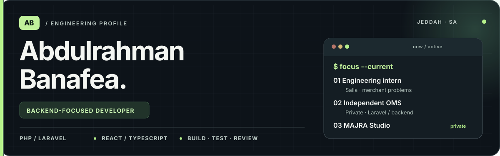
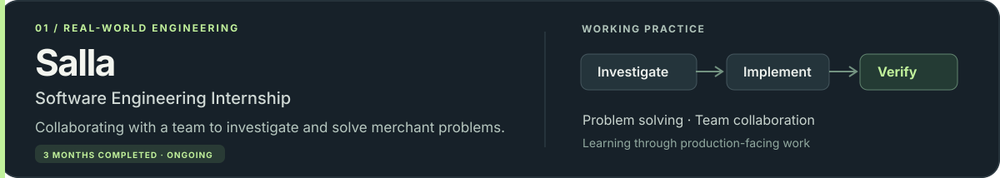
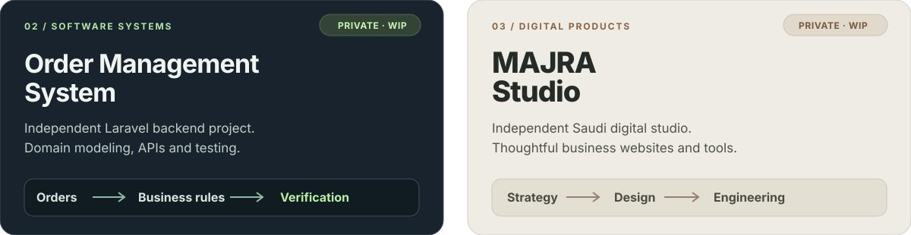
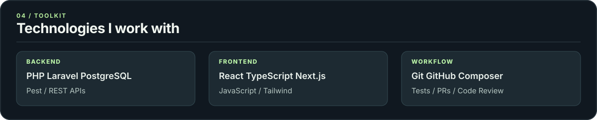

<!-- A self-hosted visual profile. All artwork lives in ./assets and works without external widget APIs. -->

<picture>
  <source media="(max-width: 600px)" srcset="./assets/profile-hero-mobile.svg">
  
</picture>

  <a href="https://www.linkedin.com/in/abdulrahman-banafea-a7237034a/">LinkedIn</a>
  &nbsp;·&nbsp;
  <a href="mailto:abdulrahmanba707@gmail.com">Email</a>
  &nbsp;·&nbsp;
  <a href="https://github.com/IAM707">GitHub</a>

I’m a **software engineering student and backend-focused developer** building practical systems with careful domain modeling, clean APIs, and tests. I enjoy connecting engineering decisions to real product needs.

### Current chapter

<picture>
  <source media="(max-width: 600px)" srcset="./assets/profile-salla-mobile.svg">
  
</picture>

### Selected work

<picture>
  <source media="(max-width: 600px)" srcset="./assets/profile-projects-mobile.svg">
  
</picture>

**OMS** — Independently building an Order Management System to strengthen backend engineering skills across relational data modeling, domain behavior, APIs, and automated testing. Planning to seek a senior engineer's technical evaluation.

**MAJRA Studio** — Building an independent Saudi digital studio focused on well-designed, useful websites and tailored web functionality for businesses.

Both projects are in development and their repositories are private. No employer code, internal details, or merchant data are shared here.

### Technical toolkit

<picture>
  <source media="(max-width: 600px)" srcset="./assets/profile-stack-mobile.svg">
  
</picture>

### Engineering mindset

**Understand the problem → Model the domain → Build incrementally → Test the behavior → Review the trade-offs.**

I’m currently focused on developing sound backend engineering judgment through hands-on work, technical feedback, and reliable implementations.

  Made with custom, self-hosted SVG artwork · No third-party stat widgets · Updated as my work evolves

