<!--
  IAM707 / GitHub profile
  Original SVG art is stored in assets/v3-*.
  Responsive art is selected with picture/source media queries.
  Skill icons: tandpfun/skill-icons. GitHub stats: anuraghazra/github-readme-stats.
  Public activity widgets cannot show source code or details from private projects.
-->

<picture>
  <source media="(max-width: 600px)" srcset="./assets/v3-hero-mobile.svg">
  
</picture>

<p align="center">
  <a href="https://www.linkedin.com/in/abdulrahman-banafea-a7237034a/"></a>
  <a href="mailto:abdulrahmanba707@gmail.com"></a>
  <a href="https://github.com/IAM707"></a>
</p>

<p align="center">
  <strong>Backend engineering · Business problems · Thoughtful product experiences</strong>
</p>

<p align="center"><sub>Engineering student | Salla software engineering intern | Independent builder</sub></p>

---

### `01` &nbsp; About me

<picture>
  <source media="(max-width: 600px)" srcset="./assets/v3-about-mobile.svg">
  
</picture>

I care about the **reason behind a technical decision**, not only whether the code runs. I'm building the habit of understanding systems, designing around real requirements, testing important behavior, and reviewing trade-offs.

### `02` &nbsp; Experience & growth

<picture>
  <source media="(max-width: 600px)" srcset="./assets/v3-journey-mobile.svg">
  
</picture>

- **Salla · Software Engineering Intern** — Three months completed and continuing. Working with an engineering team on real problems affecting merchants.
- **Independent engineering practice** — Building an Order Management System and planning a technical evaluation with a senior engineer. This is a personal development project, separate from employer systems.

### `03` &nbsp; Selected work

<picture>
  <source media="(max-width: 600px)" srcset="./assets/v3-projects-mobile.svg">
  
</picture>

<table>
<tr>
<td width="50%" valign="top">
  <strong>Order Management System (OMS)</strong><br>
  <sub>PRIVATE REPOSITORY · IN DEVELOPMENT</sub>
  <p>A personal Laravel-based backend project for practicing relational data models, business rules, APIs, and automated tests. Building it independently and seeking senior technical feedback.</p>
  <code>PHP</code> <code>Laravel</code> <code>PostgreSQL</code> <code>Pest</code>
</td>
<td width="50%" valign="top">
  <strong>MAJRA Studio</strong><br>
  <sub>PRIVATE REPOSITORY · IN DEVELOPMENT</sub>
  <p>An independent Saudi digital studio focused on bespoke business websites, content management, and useful website-connected functionality with Arabic-first design.</p>
  <code>React</code> <code>TypeScript</code> <code>UI/UX</code>
</td>
</tr>
</table>

> Both repositories are private. The descriptions here are high-level; no proprietary employer code, internal information, or merchant data is shared.

### `04` &nbsp; Technical toolkit

<div align="center">
  <p><strong>Backend & data</strong></p>
  
  <p><sub>PHP · Laravel · PostgreSQL · REST APIs · Eloquent ORM · SQL · Pest testing</sub></p>
  <p><strong>Frontend & UI</strong></p>
  
  <p><sub>TypeScript · JavaScript · React · Next.js · Tailwind CSS</sub></p>
  <p><strong>Tools & workflow</strong></p>
  
  <p><sub>Git · Pull requests · Code review · Automated tests · API debugging</sub></p>
</div>

### `05` &nbsp; How I approach engineering

```text
Understand the problem
        ↓
Identify domain rules and failure cases
        ↓
Design a small, clear solution
        ↓
Implement + test
        ↓
Review, document, improve
```

<sub>I aim for software that is understandable, testable, and useful in practice. My current focus is deepening backend engineering fundamentals through real work and deliberate practice.</sub>

### `06` &nbsp; GitHub activity

<p align="center">
  <a href="https://github.com/IAM707">
    
  </a>
</p>

<p align="center">
  <sub>Stats reflect what the public GitHub APIs expose. Most of my current engineering projects are private, so visible statistics do not represent all work.</sub>
</p>

---

<picture>
  <source media="(max-width: 600px)" srcset="./assets/v3-footer-mobile.svg">
  
</picture>

<p align="center"><a href="https://www.linkedin.com/in/abdulrahman-banafea-a7237034a/">LinkedIn</a> · <a href="mailto:abdulrahmanba707@gmail.com">Email</a></p>
